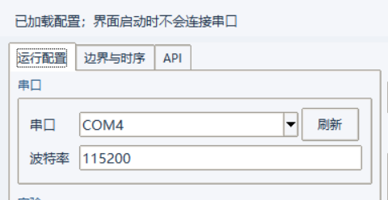
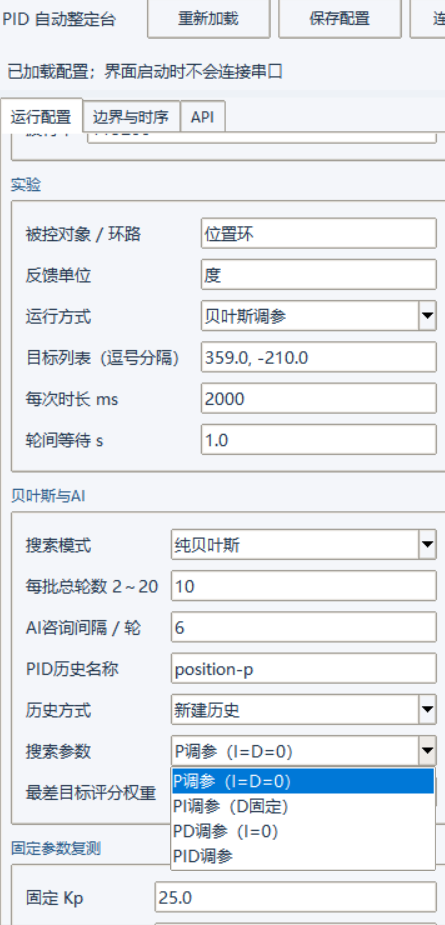
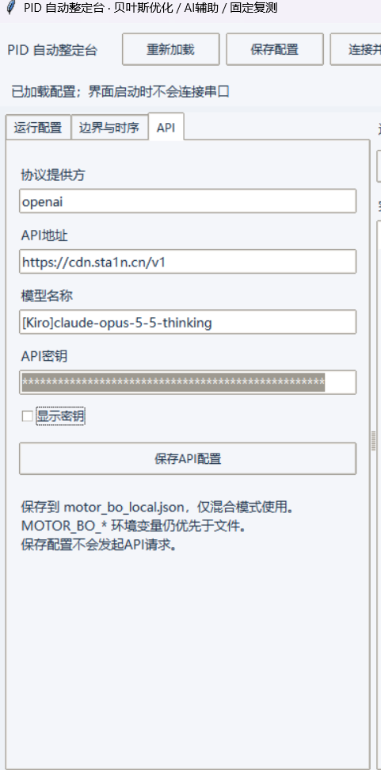
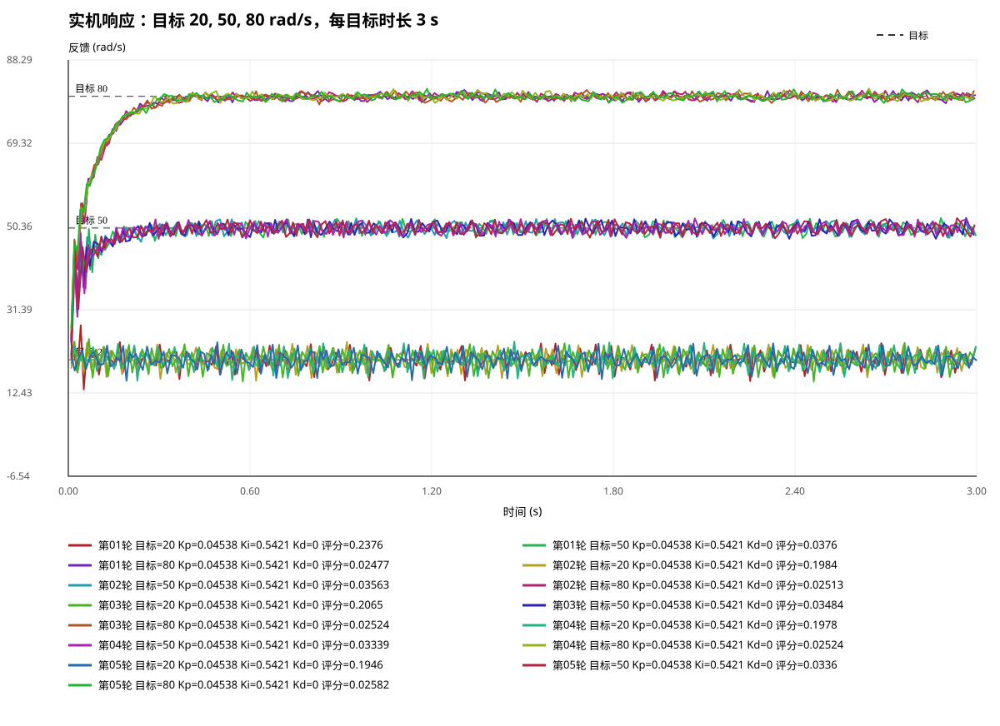

# PID 自动整定台 · Bayesian + LLM PID Tuner

通过本地图形界面完成 PID 参数搜索、AI 辅助分析和固定参数复测。软件围绕通用的“目标值 → 控制器 → 反馈值”开展试验；连接支持约定串口协议的设备后，在界面中配置目标、单位、参数范围和运行方式，即可查看曲线、评分与中文建议。位置角度、转速等是应用示例，不是软件限定的被控对象。

项目仓库：[Ledust-creat/bayes-llm-pid-tuner](https://github.com/Ledust-creat/bayes-llm-pid-tuner)。本项目基于 [LLM-PID-Tuner dev](https://github.com/KINGSTON-115/llm-pid-tuner/tree/dev)扩展，保留上游 MIT 许可；来源见 [THIRD_PARTY_NOTICES.md](THIRD_PARTY_NOTICES.md)。

## 1. 安装并打开 GUI

建议使用 Windows 与包含 Tcl/Tk 的 Python，已在 Python 3.13.6 环境验证。首次下载后，在项目目录打开 PowerShell：

```powershell
python -m venv venv
.\venv\Scripts\python.exe -m pip install -r requirements-motor-bo.txt
.\venv\Scripts\python.exe motor_bo_gui.py
```

以后直接双击 `start_motor_gui.bat` 即可。首次打开会自动准备本机默认配置，已有配置原样保留；**不用先跑仿真，也不用逐个打开或复制 JSON 文件。** 日常实机参数和 API 均在界面填写，保存后由软件管理。

GUI 启动只加载设置，不打开串口、不启动下位机。当前发布源码，首次使用仍需安装 Python 和依赖。

## 2. 在界面中配置

### 串口与试验参数

| 界面位置 | 填什么 | 操作说明 |
|---|---|---|
| 运行配置 → 串口 | 设备 COM 口、波特率 | 插入设备后点击“刷新”，选择正确端口；配套示例波特率115200 |
| 运行配置 → 实验 | 被控对象、反馈单位、目标列表、时长、轮间等待 | 多目标用逗号分隔；例如位置角度可填`60,-60`，单位填“度”，前提是设备按度收发 |
| 运行配置 → 贝叶斯与AI | 运行模式、搜索模式、轮数、AI间隔、PID类型、历史方式 | 可选P、PI、PD、PID；设备需支持所选控制器及参数 |
| 运行配置 → 参数区域 | 固定复测增益、首批基线、搜索硬边界 | 在已知可运行的基线附近设范围，不直接套用别人的参数 |
| 边界与时序 | 设备可接收的目标范围、反馈截止、评分坐标、异常判定和超时 | 按设备能力及试验要求设置；主机配置不会改变设备本地保护 |





上图以位置角度调参为例，展示目标、单位和P/PI/PD/PID选项；这些截图数值不是通用默认值。打开软件会保留你已有的配置，更换被控对象时按实际试验修改。

修改串口、试验或边界后，点击顶部 **“保存配置”**。保存只更新本机设置，不向设备发送参数；点击“连接并准备”时也会先保存。所有设置留在本机，不随源码提交。

### 选择搜索或固定复测

| 想做什么 | 在GUI里选择 | 程序行为 |
|---|---|---|
| 纯贝叶斯调参 | 运行方式“贝叶斯调参”，搜索模式“纯贝叶斯” | 自动生成候选，不调用AI |
| 贝叶斯 + AI | 运行方式“贝叶斯调参”，搜索模式“贝叶斯＋AI” | 贝叶斯选参数，AI按间隔分析并给出探索或暂停建议 |
| 固定参数复测 | 运行方式“固定参数复测”，填写固定PID与重复次数 | 不改增益、不调用AI，重复试验并统计评分 |

“每批总轮数”是搜索参数组数，“AI咨询间隔”控制多久分析一次。每组参数会依次测试全部目标；例如3个目标、5次固定复测，共执行15次目标试验。历史方式“新建历史”用于新的对象或条件，“继续同一PID”才承接已有结果。

### 可选：在 API 页配置 AI

只使用纯贝叶斯或固定复测，可以跳过 API 页。使用混合模式时，在 **“API”** 标签页填写协议提供方、API地址、模型名称和密钥，再点击 **“保存API配置”**；不用手动创建密钥文件。



截图中的地址和模型仅展示填写位置，使用时替换为自己的服务信息，密钥保持隐藏。

保存 API 不会立即请求模型。若曾配置`MOTOR_BO_*`环境变量，它们仍优先于界面保存值；使用GUI管理API时应避免另设一套冲突的环境变量。

## 3. 连接、开始与查看结果

| 顺序 | 点击或检查 | 结果 |
|---|---|---|
| ① 准备设备 | 关闭占用串口的其他软件，核对命令、单位、本地保护与紧急停止方式 | 目标与增益范围在设备允许范围内 |
| ② 连接并准备 | 点击顶部“连接并准备” | 只进行握手；成功后“确认开始”可用 |
| ③ 确认开始 | 人工检查参数后点击“确认开始” | 才开始设置PID与执行试验 |
| ④ 看结果或停止 | 查看“曲线与评分”“实时日志”“AI中文评价”；需要时点击“停止” | 保存曲线与记录；停止会请求下位机STOP并检查应答 |

曲线下方表格可以勾选显示项，也可“全部显示”“全部隐藏”或“仅显示最优组”。选定运行记录后，可以将“所选记录最优 → 复测”，或者在左侧使用“当前PID历史最优 → 复测”；导入只填写界面，不会直接运行。

实机分数越低越好，综合考虑跟踪误差、超调和调节时间。多目标还考虑最差目标，复测会给出均值和波动；换目标、单位、负载或评分条件后，应建立新历史。CSV、曲线与AI建议由软件自动保存，可用“打开记录目录”和“打开SVG曲线”查看。

## 4. 效果、适配与文档



上图是应用示例：电机速度环在20、50、80 rad/s下的多目标复测。它展示保存曲线的实际效果。

软件通过通用`target/feedback`收发数据；被控对象名称只标记记录，单位只用于说明，不会切换设备控制方式或自动换算数据。评分可选“设定值跟踪”或“坐标阶跃（如位置角度）”：例如绝对位置从−180°移动到+180°，按360°位移评价；只有采用最短路径的循环坐标才设置非零反馈周期。负值或零值属于合法反馈时，应关闭负向/近零判定。

设备仍需实现约定的串口命令与本地控制。主机停止与异常检查依赖串口，不能替代设备本地保护和紧急停止措施；示例增益需按实际对象核对。

- [GUI操作与应用示例](docs/motor_bo_gui.md)
- [下位机串口协议](docs/PROTOCOL.md)
- [开发者说明：命令行与离线测试](docs/zh-CN/MOTOR_BO.md)（不属于日常GUI上手步骤）
- [开源来源](THIRD_PARTY_NOTICES.md) · [MIT License](LICENSE)
- 应用示例 MCU 工程（电机控制）：[stm32f103-foc-mt6701](https://github.com/Ledust-creat/stm32f103-foc-mt6701)
